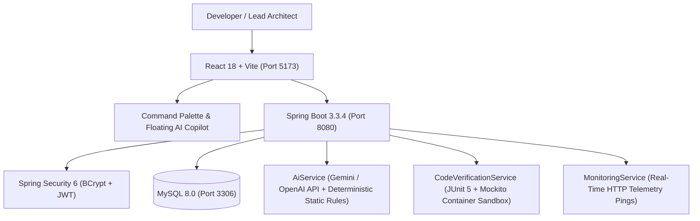

# BuildPilot AI Pro — Complete Technical Architecture & Specification

**Organization:** Orbytes Global Solutions  
**Owner:** Logaraj S  
**Date:** 2026-10-11  

---

## 1. System Overview
**BuildPilot AI Pro** is a production-grade, AI-powered full-stack developer assistant platform designed to automate code analysis, defect remediation, unit test verification, UI generation, project planning, and live production microservice telemetry.



---

## 2. Technology Stack & Compatibility
- **Frontend:** React 18, Vite 5.4, Native CSS Variables, Responsive Viewport Sandboxes.
- **Backend:** Java 17/21, Spring Boot 3.3.4, Spring Security 6, Maven 3.9.
- **Database:** MySQL 8.0 on port 3306 (`buildpilot`), Hibernate/JPA, safe schema initialization.
- **Authentication:** BCrypt password encryption with HMAC-SHA256 JWT Bearer tokens.
- **Testing:** JUnit 5, Mockito, Surefire Plugin with `-Dnet.bytebuddy.experimental=true`.
- **Containerization:** Multi-stage Dockerfiles (`backend/Dockerfile`, `frontend/Dockerfile`, `docker-compose.yml`).

---

## 3. Workspaces & Modules Catalog (All 16 Specialized Modules)

| # | Workspace Name | Component | Core Capabilities |
|---|---|---|---|
| 1 | **Dashboard** | `Dashboard.jsx` | Executive summary, KPI counters, AI Intelligence briefing banner, quick action chips. |
| 2 | **Engineering Analytics** | `Analytics.jsx` | Mean Time to Remediate (MTTR), defect velocity, test pass ratios, uptime SLA. |
| 3 | **AI Code Review Center** | `CodeReviewCenter.jsx` | File/folder upload, static analysis, line-number tags, side-by-side Git diffs, Markdown export. |
| 4 | **Design AI Studio** | `DesignStudio.jsx` | Natural-language prompt-to-React JSX/CSS with Desktop/Tablet/Mobile preview. |
| 5 | **Component Inspector** | `ComponentInspector.jsx` | Interactive prop controls, WCAG 2.1 color contrast and screen-reader accessibility audits. |
| 6 | **Database & SQL Studio** | `DatabaseStudio.jsx` | Live MySQL schema browser, SQL query runner, and AI index tuner. |
| 7 | **AI Monitor** | `ProductionMonitor.jsx` | Live HTTP microservice pings, 5ms-23ms latency telemetry, incident resolution. |
| 8 | **Error Detection & Fix** | `DebuggingStudio.jsx` | Stack trace root cause analysis, automated fix generation, JUnit verification. |
| 9 | **Deadline & Planner** | `ProjectPlanner.jsx` | Task boards, milestone roadmaps, risk forecasting, workload capacity. |
| 10 | **CI/CD Pipelines** | `PipelineStudio.jsx` | Build pipeline tracker, Surefire test stages, manual execution runner. |
| 11 | **Terminal Simulator** | `TerminalSimulator.jsx` | Sandboxed CLI container (`mvn test`, `docker ps`, `curl health`, `git status`). |
| 12 | **Production Monitoring** | `ProductionMonitor.jsx` | Microservice SLA tracking, outage alerts, response time graphs. |
| 13 | **Compliance Certificate** | `ComplianceCertificate.jsx` | Official printable PDF deployment sign-off certificate with verification hash. |
| 14 | **AI Mentor Chat** | `AiMentorChat.jsx` | Dedicated ChatGPT/Gemini conversational assistant with project context binding. |
| 15 | **Prompt Library** | `PromptLibrary.jsx` | Categorized battle-tested developer prompts (DDD, Mockito, Security, N+1 fix). |
| 16 | **Team Workspace** | `TeamWorkspace.jsx` | RBAC matrix (`LEAD`, `DEVELOPER`, `QA`, `DEVOPS`), project member invites, audit feed. |

---

## 4. REST API Endpoint Reference

### Authentication & Account
- `POST /api/auth/login`: Issue JWT token for valid credentials.
- `POST /api/auth/register`: Register new account with role.
- `GET /api/auth/me`: Fetch authenticated user profile.
- `POST /api/auth/logout`: Invalidate session.

### Projects & Issues
- `GET /api/projects`: List active tenant projects.
- `POST /api/projects`: Create project.
- `GET /api/dashboard?projectId={id}`: Aggregated metrics across all modules.
- `GET /api/issues?projectId={id}`: Defect inventory sorted by severity.
- `POST /api/issues/{id}/repair`: Resolve defect and record verified fix.
- `POST /api/issues/repair-all`: Batch resolve open project defects.

### AI Reviews & Debugging
- `POST /api/reviews`: Execute static analysis and AI review on uploaded code.
- `GET /api/reviews?projectId={id}`: Review history.
- `PATCH /api/reviews/findings/{id}`: Accept or reject suggested diff finding.
- `POST /api/debugging/diagnose`: Analyze stack trace and propose fix.
- `POST /api/debugging/fixes/{id}/verify`: Execute sandbox verification test suite.

### Design, Planner & Telemetry
- `POST /api/design/generate`: Prompt-to-JSX component generation.
- `GET /api/planner/tasks`: Project task board items.
- `GET /api/planner/forecast`: AI workload capacity and deadline risk calculation.
- `POST /api/monitoring/services/{id}/ping`: Execute live HTTP ping and record latency.
- `POST /api/chat/send`: Conversational AI chat with multi-turn history.

---

## 5. One-Click Quickstart Instructions

### Prerequisites
1. **Java 17 or 21** (`java -version`)
2. **Node.js 18+** (`node -v`)
3. **MySQL 8.0** running on port 3306 with credentials:
   - User: `root`
   - Password: `NewPassword@123`
   - Database: `buildpilot`

### One-Click Launch
Double-click `start_all.bat` in the project root:
```cmd
start_all.bat
```
Or run manually:
```powershell
# 1. Run Spring Boot Backend
.\mvnw.cmd spring-boot:run

# 2. Run Vite Frontend
cd frontend
npm run dev
```

### Demo Login Credentials
- **Email:** `demo@buildpilot.dev`
- **Password:** `demo123`
*(Or register any new account with LEAD, DEVELOPER, QA, or DEVOPS role)*
