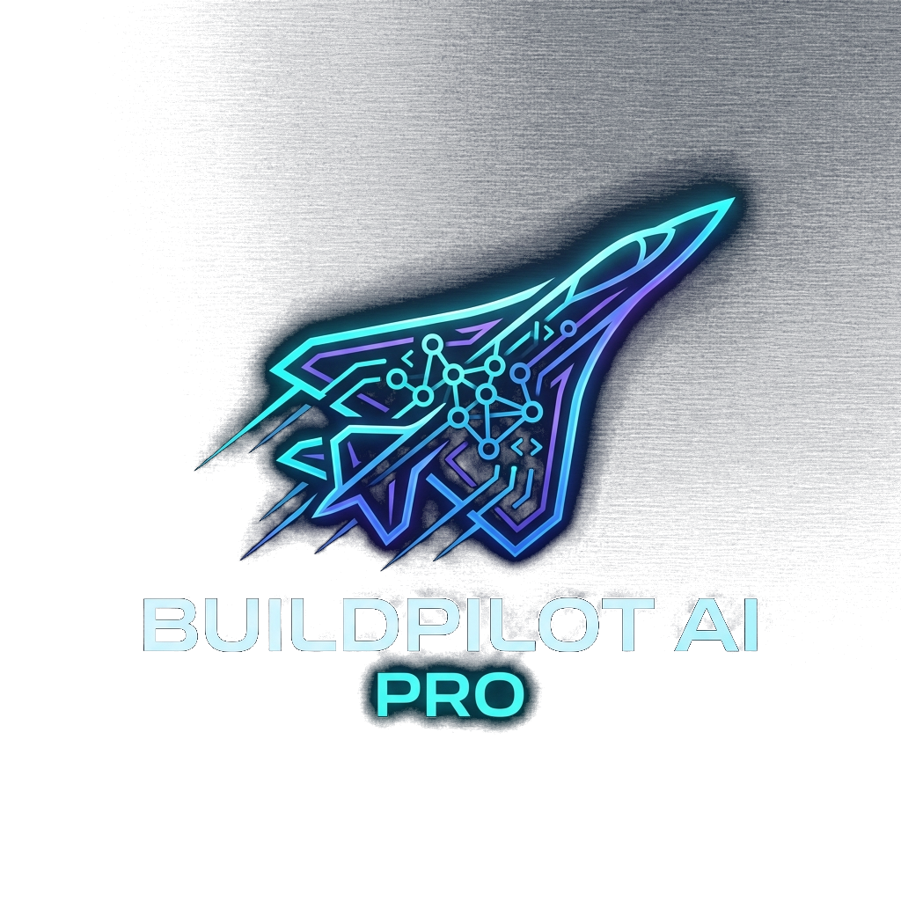

<!-- Organization: Orbytes Global Solutions, Owner: Kirthik, Created at: 2026-10-12 -->
<!-- Description: Complete production documentation and portfolio guide for BuildPilot AI Pro -->

<p align="center">
  
</p>

<h1 align="center">BuildPilot AI Pro</h1>

<p align="center">
  <b>Enterprise-Grade, AI-Powered Full-Stack Engineering Assistant Platform</b><br />
  <i>Static Code Analysis • Automated Test Generation • Stack Trace Diagnosis • Multi-Cloud Deployment • SBOM & FinOps</i>
</p>

<p align="center">
  
  
  
  
  
  
</p>

---

## 1. Executive Summary

**BuildPilot AI Pro** is a unified, developer-centric platform designed to accelerate software engineering lifecycles. It merges heuristic static analysis, real LLM models (Google Gemini & OpenAI), in-browser code exploration, relational database schema visualization, and cloud DevOps utilities into a single, cohesive developer workspace.

---

## 2. Platform Architecture

```
                    ┌─────────────────────────────────────────┐
                    │      React 18 Single Page App           │
                    │   Vite + Glassmorphism UI + Favicon     │
                    └────────────────────┬────────────────────┘
                                         │ REST API / JWT
                                         ▼
                    ┌─────────────────────────────────────────┐
                    │       Spring Boot 3.3.4 REST API        │
                    │    Spring Security 6 (BCrypt / JWT)     │
                    └───────────┬─────────────────┬───────────┘
                                │                 │
               JDBC / JPA       │                 │ HTTP REST
                                ▼                 ▼
        ┌─────────────────────────────┐    ┌───────────────────────────┐
        │       MySQL 8.0 Engine      │    │  Google Gemini / OpenAI   │
        │  Projects, Issues, Reviews  │    │  Generative AI Services   │
        └─────────────────────────────┘    └───────────────────────────┘
```

---

## 3. Complete Module Catalog (30 Modules)

### 📊 Overview & Telemetry
1. **Dashboard**: Project health index, defect distribution, live entity counters.
2. **Engineering Analytics**: Defect resolution velocity and severity telemetry dynamically computed from MySQL.
3. **AI FinOps & Tokens**: Multi-model token consumption tracking (Gemini, GPT-4o, Claude, Ollama) with cost limits.

### 🛠️ Architecture & Build
4. **Code Review Center**: Static security vulnerability scans, SQL injection prevention, and auto-patch generation.
5. **Repository Explorer & Editor**: Full project tree view (Java, React, SQL, Docker) with in-browser syntax code editor.
6. **Visual ER Schema Studio**: Interactive entity-relationship diagrams for database tables with instant SQL DDL export.
7. **Design AI Studio**: AI UI wireframing, color palette generator, and responsive previews.
8. **Component Inspector**: Real-time WCAG 2.1 AA accessibility inspector and contrast ratio calculation.
9. **AI Test Generator**: Automated unit test generation (JUnit 5 & Jest) with 1-click test suite export.
10. **OpenAPI Explorer**: Interactive REST API documentation with live test payloads and cURL generation.
11. **Big-O Complexity Profiler**: Time and space algorithmic complexity profiler with automated optimization suggestions.
12. **Database & SQL Studio**: Live MySQL query editor with table schema inspection.
13. **AI System Monitor**: Latency percentiles, throughput metrics, and resource telemetry.

### 🚀 Fix, Ship & DevOps
14. **Error Detection & Repair**: Full stack-trace diagnostics, root cause explanations, and 1-click database defect repairs.
15. **Deadline & Sprint Planner**: Delivery risk scoring, milestone progress bars, and team velocity projections.
16. **CI/CD Pipeline Studio**: Interactive build pipeline simulator with commit tracking, test stage logs, and manual triggers.
17. **Git Branches & PR Visualizer**: Visual git commit graph, feature branch simulator, and PR merge conflict detection.
18. **Multi-Cloud & Kubernetes Studio**: Ready-to-use Terraform modules, Helm deployment charts, and rollout dispatchers.
19. **SBOM & Vulnerability Audit**: Software Bill of Materials (CycloneDX format) generator with CVE auto-patching.
20. **Incident Webhook Studio**: Real-time alerting webhook dispatcher supporting Slack and Discord payloads.
21. **Terminal Simulator**: Interactive developer shell with command auto-completion and server logs.
22. **Production Health Monitoring**: Real-time service uptime tracking, response time graphs, and incident histories.
23. **Release Notes Generator**: Automated AI changelog and semantic versioned release notes compiler.
24. **Compliance Certificate Generator**: Formal security audit verification certificate generator with PDF export.

### 👥 Learn & Collaborate
25. **AI Mentor Chat**: Interactive senior software architect pairing assistant.
26. **AI Tools & LLM Hub**: Model benchmarking suite comparing Gemini, OpenAI, Claude, and local Ollama instances.
27. **Live Code Pairing Room**: Multi-user simulated code pairing room with live participant badges.
28. **Prompt Engineering Library**: Categorized production prompts for refactoring, security reviews, and unit test generation.
29. **Team Workspace**: RBAC role assignment (`DEVELOPER`, `REVIEWER`, `LEAD`, `ADMIN`) and member invitations.
30. **Command Palette (`Ctrl + K`)**: Quick keyboard switcher providing instant access to all 30 modules.

---

## 4. Quick Start & Local Execution

### Prerequisites
- Java 17+
- Node.js 18+
- MySQL 8.0 on port 3306

### 1. Database Setup
```sql
CREATE DATABASE IF NOT EXISTS buildpilot;
```
Default credentials: `root` / `NewPassword@123` (configurable in `.env.production`).

### 2. Run Backend (Port 8080)
```bash
cd backend
./mvnw spring-boot:run
```

### 3. Run Frontend (Port 5173)
```bash
cd frontend
npm install
npm run dev
```

Open `http://localhost:5173` in your browser.
- **Default Credentials**: `demo@buildpilot.dev` / `demo123` (or register a new user).

---

## 5. Automated Backup & Disaster Recovery
Run the automated MySQL backup script:
```powershell
.\scripts\backup_database.ps1
```
Backups are archived in the `backups/` directory with automatic timestamps.

---

## 6. Organization & Ownership
- **Organization**: Orbytes Global Solutions
- **Owner**: Kirthik
- **Repository**: BuildPilot AI Pro
